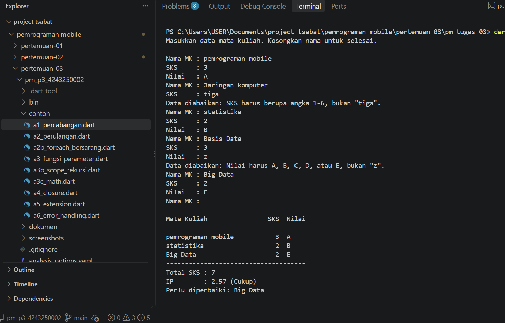

# Tugas Rutin 3 — Kalkulator IP Semester (Console)

Pemrograman Mobile (3KOM40215) · Pertemuan 3 · Ilmu Komputer UNIMED

## a. Identitas

| | |
|---|---|
| Nama  | Muhammad Tsabat Muhyiyuddin |
| NIM   | 4243250002 |
| Kelas | PSIK24D |
| GitHub | [tsabat15](https://github.com/tsabat15) |

## Cara menjalankan

```
dart run bin/kalkulator_ip.dart
```

Kosongkan nama mata kuliah untuk selesai dan mencetak KHS.

## b. Satu sesi dengan input salah

Sesi berikut memuat dua input salah: SKS `tiga` dan nilai `z`. Keduanya diabaikan dan program tetap berjalan. IP sesi ini adalah (3×4 + 2×3 + 2×0) ÷ 7 = 18 ÷ 7 = 2.57.



Catatan: contoh di modul menulis IP 3.00 untuk nilai A (3 SKS), B (2 SKS), dan D (2 SKS), padahal hitungannya (3×4 + 2×3 + 2×1) ÷ 7 = 20 ÷ 7 = **2.86**. Program ini mencetak 2.86 untuk data tersebut.

## c. Higher-order function dan error handling

Higher-order function saya pakai di tiga tempat. `hitungIp` dan `hitungTotalSks` memakai `fold` dengan fungsi penjumlah untuk menghitung Σ SKS × bobot dan Σ SKS. `perluDiperbaiki` memakai `where` dengan fungsi penyaring untuk memilih mata kuliah berbobot di bawah 2. `cetakKhs` memakai `sort` dengan fungsi pembanding saat parameter bernama `urutkan` bernilai true, sehingga KHS tersusun dari nilai tertinggi.

Error handling dipisah menjadi dua peran. `validasiSks` dan `validasiNilai` hanya memeriksa input dan melempar `FormatException` bila tidak valid. `main` menangkapnya di satu tempat dengan `try` dan `on FormatException`, mencetak pesan "Data diabaikan", lalu melanjutkan perulangan. Dengan cara ini data yang salah dibuang tanpa menghentikan program, dan fungsi validasi tetap pendek karena tidak perlu tahu cara menampilkan pesan.

## d. Pernyataan penggunaan AI

Saya menggunakan asisten AI untuk membantu menyusun kode, menguji sesi input salah, dan menulis README ini. Saya bertanggung jawab memahami seluruh isinya.
